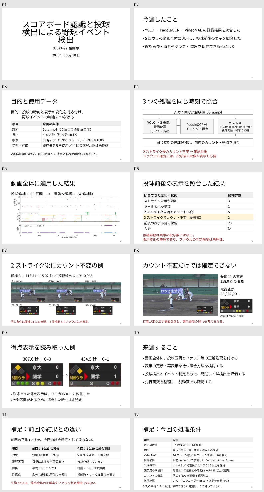

# 2026年10月30日 棚橋 発表資料

棚橋の10月23日資料の書式を使い、今週のYOLO・PaddleOCR・VideoMAEの統合実験をまとめた資料です。
本編10枚、質疑用の補足2枚。PowerPointのノート欄にも読み上げメモを入れています。

- [PowerPoint](M棚橋261030.pptx)
- [スライドPDF](slides.pdf)
- [発表メモ・想定質問15問を読む](speaker_notes.md)
- [発表メモWord](speaker_notes.docx)
- [発表メモPDF](speaker_notes.pdf)
- [発表メモTXT](speaker_notes.txt)

PPTXを開いたページで「Download raw file」を使うと、PowerPointファイルを保存できます。

投球区間の65候補を34候補群に整理した結果を報告しています。2ストライク後カウント不変は2候補群、表示不足は23候補群です。ファウルは未確定で、今回の動画の正解注釈による精度評価は未実施です。
