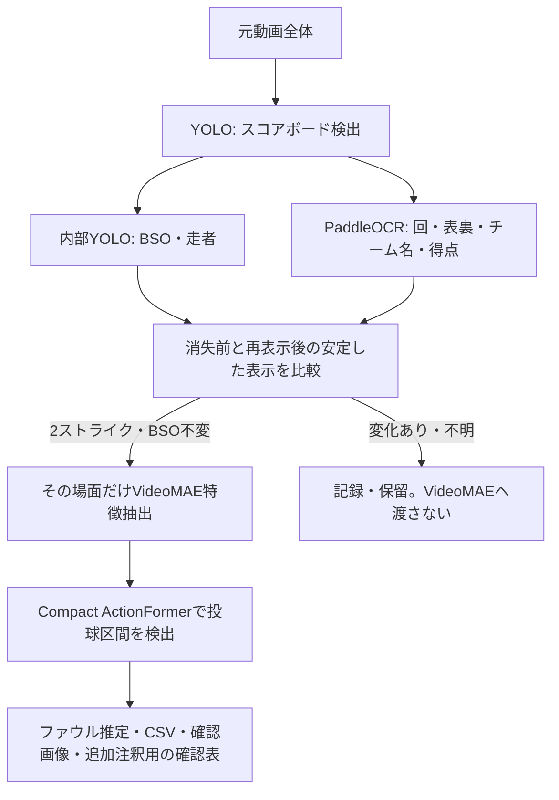

# 2ストライク後のファウル候補だけにVideoMAEを使う統合プログラム

**更新：10本の参考場面をtest.mp4から探してMP4へ書き出し、BSO・VideoMAEで確認する新モードを追加しました。[新しい実行手順はこちら](REFERENCE_EXTRACTION.md)。** 以下は、比較・再現用に残した旧「表示が消えて再表示」モードの手順です。

動画全体からYOLOでスコアボードを検出し、2段階目のYOLOでB/S/Oの点灯ランプと走者を読み、PaddleOCRで回・表裏・チーム名・得点を記録します。その後、スコアボードの消失・再表示を調べ、**消失前が2ストライク、再表示後もBSO不変**の場面だけをVideoMAE＋既存Compact ActionFormerへ渡します。

**動画全体へのVideoMAE実行、過去の全体推論結果からの後付け抽出は行いません。** 実際に渡した16フレームの範囲をすべて記録し、対象外のフレームが混じらないことを別のコマンドで検査できます。

## 処理の流れ



スコアボードが消える前の投球動作も必要なので、対象範囲には消失直前の映像を最大8秒含めます。画面から消えている間だけを分析すると、肝心の投球が抜けるためです。離れた場面は別々に解析し、つなぎ合わせません。

## Windowsで実行する

このフォルダーを、手元の `C:\Users\yutan\kenkyuu\for_labelimg\two_strike_foul` に置く例です。元動画、既存のモデル、元のスクリプトは変更しません。

### 1. 既存のPython環境と重みを設定する

PowerShellで実行します。コマンドは1行ずつ入力してください。

```powershell
cd C:\Users\yutan\kenkyuu\for_labelimg\two_strike_foul
python configure_windows.py --project "C:\Users\yutan\kenkyuu\for_labelimg"
```

設定ツールは、既存のConda環境から各ライブラリーを使えるPythonを探して `config.local.json` に保存します。パッケージのインストールや既存環境の変更はしません。

自動で探す重みは次のとおりです。

| 役割 | 既存ファイル |
|---|---|
| スコアボード | `runs/detect/scoreboard_model-2/weights/best.pt` |
| BSO・走者 | `runs/detect/bso_inner_no_empty-3/weights/best.pt` または `bso_inner_model/weights/best.pt` |
| 投球区間 | このプログラム内の `models/compact_actionformer.pth`（更新版ZIPに同梱）、または手元の既存ファイル |
| OCR検出・認識 | `%USERPROFILE%\.paddlex\official_models\PP-OCRv6_medium_det` と `PP-OCRv6_medium_rec` |

投球区間の重みが別の場所にあれば、場所を指定して設定します。

```powershell
python configure_windows.py --project "C:\Users\yutan\kenkyuu\for_labelimg" --pitch-checkpoint "実際の保存先\compact_actionformer.pth"
```

環境を自動で見つけられない場合は `--yolo-python`、`--ocr-python`、`--pitch-python` に各環境の `python.exe` を指定できます。`yolov8n.pt`・`yolo26n.pt`は汎用物体検出用なので、専用スコアボード重みの代わりに使わないでください。

### 2. 実行前の確認

```powershell
python run_foul_pipeline.py --config config.local.json --preflight
```

`"ready": true` なら実行できます。`false` の場合は、表示されたパスまたはPython環境を確認します。VideoMAEの学習済みエンコーダーは、初回にHugging Faceから取得するため通信が必要です。既存のキャッシュがあれば利用します。

### 3. test.mp4を実行

```powershell
python run_foul_pipeline.py --config config.local.json --video "..\test.mp4" --output "..\results_test_foul_only"
```

すでに同名の結果フォルダーがある場合は、別の名前にするか、下の再開コマンドを使います。結果を上書きしません。動画の末尾までスコアボードを調べます。処理中は30秒ごとに進行中の段階を表示し、詳細は結果フォルダー内の `yolo.log`、`ocr.log`、`pitch.log` に保存します。

短い動画で先に確認する場合：

```powershell
python run_foul_pipeline.py --config config.local.json --video "..\1urafaul1.mp4" --output "..\results_foul1"
```

同じフォルダーにある `*faul*.mp4` を1本ずつまとめて実行する場合：

```powershell
python run_batch.py --config config.local.json --input-dir ".." --output "..\results_foul_clips"
```

### 4. 結果を見る

```powershell
python open_results.py "..\results_test_foul_only"
```

ブラウザーで確認ページが開きます。元動画を選ぶと各場面に移動できます。動画を外部へ送信する処理はありません。今回は手元のパソコンに結果を作るため、チャット画面のファイルダウンロード機能を使う必要はありません。

### 5. 対象範囲を検査する

```powershell
python verify_scope.py "..\results_test_foul_only"
```

`passed: true`、`outside_gate_clips: 0` を確認します。これは適用範囲の検査であり、ファウル判定の精度ではありません。

### 中断・再開

```powershell
python run_foul_pipeline.py --resume "..\results_test_foul_only"
```

完了済みの段階は元動画・重み・設定・コード・入力の整合性を確認して再利用します。VideoMAEの特徴量は選ばれた区間ごとに保存します。未完了の段階はやり直します。元動画や設定を変えて比較する場合は新しい結果フォルダーで実行してください。

VideoMAEに進む前に対象区間だけ確認することもできます。

```powershell
python run_foul_pipeline.py --config config.local.json --video "..\test.mp4" --output "..\gate_check" --stop-after gate
```

`gate_check\gate.json` に対象・除外の理由が出ます。その後 `--resume "..\gate_check"` でVideoMAE以降を実行できます。

## 24投球と、ファウルだけの適用範囲

過去の10本には、ファウル後の次の投球も含まれます。**「24投球すべて」と「BSO不変の場面だけ」は同じ範囲とは限りません。** 次の投球でボールやアウトが増えれば、既定の条件ではVideoMAEを実行しません。検出数を24に合わせて増やす処理もありません。

比較研究として直後の投球も調べる場合だけ、次を指定します。

```powershell
python run_foul_pipeline.py --config config.local.json --video "..\test.mp4" --output "..\results_test_with_comparison" --include-following-pitch
```

この設定は、条件一致の再表示から最大45秒の追加範囲を比較用に解析し、その範囲で最初にスコア0.5以上となる投球候補を記録します。次の投球でスコアボードが消えない場合や、動画が再表示前に終わる場合もあるので、「次の消失」を「次の投球」とは扱いません。比較用の結果は `following_pitch_comparison` として分け、ファウル推定に数えません。誤検出や見逃し、45秒より長い投球間隔があるため、直後の実際の投球との目視照合は必要です。

## 保存されるもの

| ファイル | 内容 |
|---|---|
| `index.html` | 対象区間、投球スコア、前後画像、元動画への移動 |
| `timeline.png` | 対象範囲・投球候補・BSO・走者・得点を並べたグラフ。青は正解ではなく適用範囲 |
| `scoreboard.csv` | 全時刻のBSO・走者・回・表裏・チーム名・得点。不明は空欄 |
| `gate.json` / `gate_decisions.csv` | 表示の消失・再表示、前後の安定値、対象／除外の理由 |
| `foul_candidates.csv` / `events.json` | ファウル推定と投球検出区間。比較用の投球は別のrole |
| `pitch_proposals.csv` | 対象範囲内の全投球候補。重複した低スコア候補も保存 |
| `encoded_ranges.csv` | VideoMAEへ渡した全16フレーム範囲。元動画のフレーム番号 |
| `scope_verification.json` | `verify_scope.py` による適用範囲の検査 |
| `evidence/` | 元動画から抽出した前後画像 |
| `annotation_review/` | 確認すべき画像、内部切り抜き、空の確認表、モデルの予測 |
| `observations.jsonl` | 原始的な検出枠・信頼度・OCR文字列などの記録 |
| `summary.json` / `diagnostics.json` | 実行結果と見直し項目 |

時刻は入力動画の先頭を0秒とします。フレーム範囲は0始まりで、`end_frame_exclusive` は末尾を含みません。CSVはExcelで開きやすいUTF-8 BOM付きです。

## 判定条件と限界

- 全体のYOLOは既定で0.5秒間隔。連続2回以上の未検出で消失、連続2回以上の検出で再表示とします。検出失敗でも消失扱いになる可能性があるため、前後画像を保存します。
- 消失前・再表示後のBSOは3回以上連続して一致することを求めます。再表示後1秒を置き、その後最大6秒の中で安定した表示を確認します。この時間は実験用の設定で、全場面の更新を保証しません。
- 再表示直後が元の値でも、その後に安定した別のBSOが出れば対象から外します。画面に見えているのにBSOを読めない場合を「消失」とは扱いません。
- 既知の走者・得点・回・表裏が変われば対象から外します。文字や走者が不明な場合は、不明な項目を残してBSO条件で選びます。走者の未検出は空塁と区別できない場合があり、点灯ランプの見落としもカウントを小さくする場合があります。
- そもそも表示が消えないファウル、消失前や再表示後が動画に入っていない場面は、この条件では扱えません。これをアノテーション不足と混同しないでください。
- 同じBSOでの再表示と投球動作だけでは、ファウルを完全には確定できません。リプレイ、牽制、表示更新の遅れ等も目視確認します。現モデルは打球接触やファウルそのものを学習した分類器ではありません。
- `inferred_two_strike_foul` は「条件一致＋投球スコア0.5以上」の推定です。スコアはファウルの確率ではなく、0.5も今回の操作上のしきい値です。検証による校正済みの値ではありません。最終確認用の `confirmed_foul` は空のままです。
- 投球モデルは既存の**簡略化Compact ActionFormer**です。公式ActionFormerの完全実装ではありません。元の16フレーム・8フレーム間隔・768次元特徴を使います。入力動画のフレームレートを落としません。画像処理は学習済みVideoMAEの標準プロセッサーに従います。
- 最後の8未満の端数フレームは不均一なストライドを避けて特徴窓に足しません。推論区間は各対象範囲内に切り詰めます。
- 放送の右下の特定レイアウト向けです。異なる配置・配色の試合ではROI・点灯位置・学習データの見直しが必要です。
- `test.mp4` の完全版は今回のクラウド検証の入力にありません。手元の完全版は上記コマンドで実行してください。長い動画の処理時間はCPU/GPUと対象場面数で変わり、1時間以内とは保証できません。検証結果は `VALIDATION.md` を参照してください。

## アノテーションを追加する前に

`annotation_review/review.csv` と画像を確認します。`true_*` に目視の正解を入れ、次を実行できます。

```powershell
python audit_annotations.py "..\results_test_foul_only\annotation_review\review.csv"
```

既存データの枚数・クラス分布も確認できます。

```powershell
python dataset_inventory.py --dataset "..\dataset_inner" --kind inner --output inner_inventory.json
python dataset_inventory.py --dataset "..\dataset_scoreboard" --kind scoreboard --output scoreboard_inventory.json
```

追加の優先順位は、実際に見落とした点灯ランプ・占有塁、表示の出入り、圧縮や縮小で小さくなった表示、既存データに少ない走者配置です。チーム名や回の誤読はOCRの問題なので、BSOの矩形注釈を増やすだけで直るとは限りません。

学習画像は、同じコマに映る全対象を漏れなく付けます。第1段階は元画面にscoreboard、第2段階は余白付きスコアボード切り抜きにball/strike/out/runnerを付けます。現モデルは点灯・占有を4クラスで学習しているため、消灯や空塁にこれらのラベルを付けないでください。未検出を自動で負例にしたり、予測枠をそのまま正解にしたりはしません。

再学習時は動画・試合単位で学習と評価を分け、今回の検証動画を見ながら調整した結果を「独立した精度」として報告しないでください。データの不足は枚数だけでは断定できません。**実際の失敗画像、既存の学習データ、分離評価**を合わせて判断します。

## 環境を新しく作る場合だけ

既存環境が動く場合は不要です。Python 3.12を前提に、YOLO・PaddleOCR・投球モデルを別環境に保ちます。

```powershell
conda create -n foul-yolo python=3.12 -y
conda run -n foul-yolo python -m pip install -r requirements.yolo.txt
conda create -n foul-ocr python=3.12 -y
conda run -n foul-ocr python -m pip install -r requirements.ocr.txt
conda create -n foul-pitch python=3.12 -y
conda run -n foul-pitch python -m pip install -r requirements.pitch.txt
```

上の例はCPU構成です。GPUを使う場合は、GPUに対応するPyTorch/PaddlePaddleをそれぞれ用意し、`config.local.json` の `pitch.device` を `cuda`、YOLOは `yolo.device` を `0` などに変更します。異なる環境のCUDA対応はそれぞれ確認してください。CPUの既定精度はfloat32です。クラウド検証では対応CPUでbfloat16を使ったため、実行条件を結果に記録しています。

## 自動検証

```powershell
python -m unittest discover -s tests -v
```

BSO変化、アウト後のリセット、表示遅延、不明値、1回だけの未検出、別レイアウト、対象が0件の場合にモデルを起動しないこと、対象外フレームを渡さないこと等を確認します。
