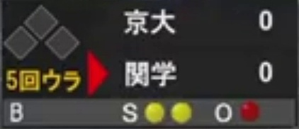

# 新しい参考場面モードの検証（2026年11月5日）

今回の検証は、既知の10場面を探して書き出す機能と、BSO・VideoMAEによる確認を分けています。`test.mp4` 完全版はこの環境へ取り込めていないため、そこから10本を実際に抽出した結果とは主張しません。

## 640×360の照合・書き出し検証

参考10本を640×360へ縮小・再圧縮し、先頭に2.3秒、各動画の間に0.9秒の無地映像を入れた388.93秒の検証用動画を作りました。参考動画の位置を全体動画側へ直接指定せず、画像の照合だけで探しています。

| 参考動画 | 見つけた開始時刻（秒） | 照合値 |
|---|---:|---:|
| 1urafaul1.mp4 | 2.300 | 0.9989 |
| 2omotefaul2.mp4 | 24.167 | 0.9989 |
| 2urafaul3.mp4 | 89.267 | 0.9983 |
| 4omotefaul4.mp4 | 115.733 | 0.9984 |
| 4urafaul5.mp4 | 174.333 | 0.9987 |
| 5omotefaul6.mp4 | 196.767 | 0.9987 |
| 5omotefaul7.mp4 | 225.633 | 0.9987 |
| 5urafaul8.mp4 | 280.700 | 0.9990 |
| 7urafaul9.mp4 | 338.967 | 0.9976 |
| 8urafaul10.mp4 | 365.133 | 0.9988 |

10場面すべてを正しい位置で照合し、10本のMP4へ保存しました。既知の埋め込み位置との誤差は、この検証では数値計算の丸め誤差の範囲でした。各MP4をOpenCVで開き、書き出し時間も検査しています。これは同じ映像の縮小・再圧縮への動作確認です。未知のファウルの検出精度を示す値ではありません。

## 実際の長い動画での確認

保存済みの530.2秒の `5ura.mp4` に参考10本を照合すると、含まれる `5urafaul8.mp4` だけを **102.633〜160.000秒** に照合し、他の9本を未発見としました。音声付きH.264/AACのMP4へ切り出せることをFFprobeでも確認しています。

この場面と前後のみでYOLO・PaddleOCRを新たに実行し、3投球を確認しました。

| 投球 | BSOの比較 | 処理結果 | 投球スコア | 試作ファウルスコア |
|---|---|---|---:|---:|
| 1 | 0/2/1 → 0/2/1 | ファウル確認用候補をMP4保存 | 0.968015 | 0.508335 |
| 2 | 0/2/1 → 0/2/1 | ファウル確認用候補をMP4保存 | 0.944647 | 0.509218 |
| 3 | 0/2/1 → 1/2/1 | BSO変化によりVideoMAE対象外 | — | — |

1・2球目にだけVideoMAEを実行し、53個の16フレーム入力窓を記録しました。対象外の投球への入力は0件です。3球目はボール数が0→1となり、VideoMAEを実行していません。

### アウトランプの見落としも確認

元画像では赤いアウトランプが1個ありますが、YOLOは0アウトと読みました。117.5〜122.0秒の一部でも同様の読み落としがありました。この値を実際のカウント変化と扱うと、1球目を落とします。

最初の動作確認でこの問題を確認した後、同じ回・表裏、同じB/S、最後に元のBSOへ3回以上安定して戻る、という条件に限り、一時的なアウト減少を比較から外す処理を追加しました。元の0アウトという出力はCSV・JSONに残し、除外した読み取りを `ignored_inconsistent_out_drops` に記録しています。この処理は表示を正しく読み直したこととは異なり、推定候補には引き続き目視確認が必要です。

このような失敗画像は追加のBSO注釈候補です。ただし、学習データの不足が原因かは既存データとの照合が必要です。アウトの点灯を見落とした画像、似た大きさ・画質・配置の画像を集めて評価します。

## 参考24投球の試作ファウル判別

VideoMAEの特徴量から、投球付近〜投球後の映像を使うロジスティック回帰を作りました。対象の参考動画を学習から外し、残り9本で学習して判定する方法です。

| 参考注釈 | ファウルと判定 | それ以外と判定 |
|---|---:|---:|
| ファウル15投球 | 12 | 3 |
| それ以外9投球 | 4 | 5 |

参考注釈との一致は17/24です。非ファウルをファウルと判定する例が4件あり、確定判定として使える段階ではありません。参考注釈は過去の近似的な目視整理で、独立したユーザーの確定ラベルではありません。また同じ試合の10本なので、別試合への性能も未検証です。

推論時の判別器も対象の参考動画を学習から除外したものを使います。モデルの再現スクリプトで、配布した係数と完全一致することを確認しました。C=1、クラス重みbalanced、判定しきい値0.5を固定し、今回の検証結果を見て調整していません。

## その他の確認

- 35件の自動テストが通過しました。表示が消えないBSO不変、遅れて増えるカウント、アウトの一時減少、同じ場面の重複・リプレイ、未発見、不明なBSOでモデルを起動しないこと等を含みます。
- 見つかった場面の数を10に合わせる処理はありません。照合が弱い場面や、重複する場面は保留します。
- 参考10本は、以前パーツから復元・保存したファイルを使用しました。[入力情報](validation/inputs.json)を記録しています。
- Linux CPUで確認しました。Windows実機では未実行です。VideoMAEのエンコーダーは既存の固定モデル、実動画確認ではbfloat16、投球区間検出は既存の簡略化Compact ActionFormer・float32です。
- 旧「表示消失」モードの検証記録は[VALIDATION.md](VALIDATION.md)に残しています。今回の9投球というBSO条件一致数は、旧短動画の認識出力を新条件で比較した値です。test.mp4全体での検出数やファウル正解数ではありません。

機械可読の記録は [validation/reference_workflow/](validation/reference_workflow/) と [validation/outcome_pilot.json](validation/outcome_pilot.json) にあります。

## 640×360でのBSO・VideoMAE一連の確認

検証用動画の1urafaul1の場面でもYOLO・OCRから新たに実行し、1球目をBSO不変の候補として選び、VideoMAEと両判別処理を実行して確認用MP4を保存しました。投球スコアは0.961766、試作ファウルスコアは0.513045でした。対象外への入力は0件です。

この検証用動画では参考クリップの後に別の回の映像をつないでいるため、2球目の後続カウントは実際の試合の結果評価に使いません。test.mp4と同じ解像度で一連の処理が動くことを確認するための試験です。
