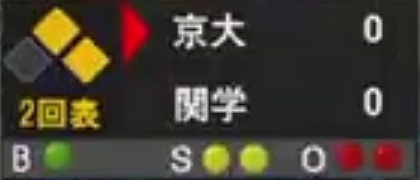
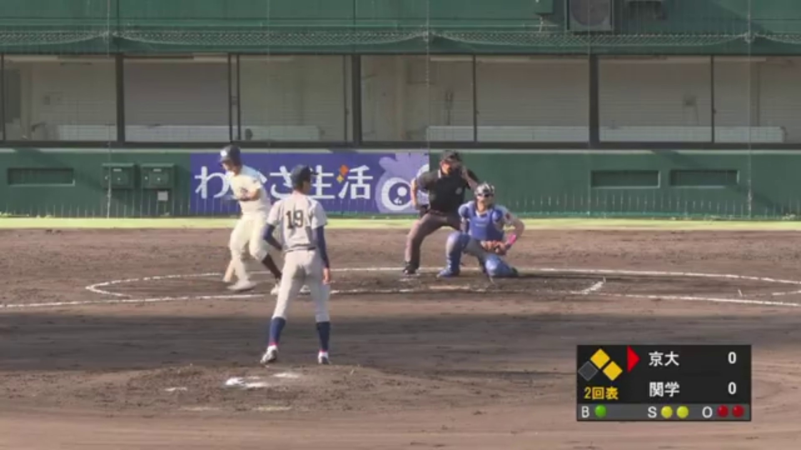
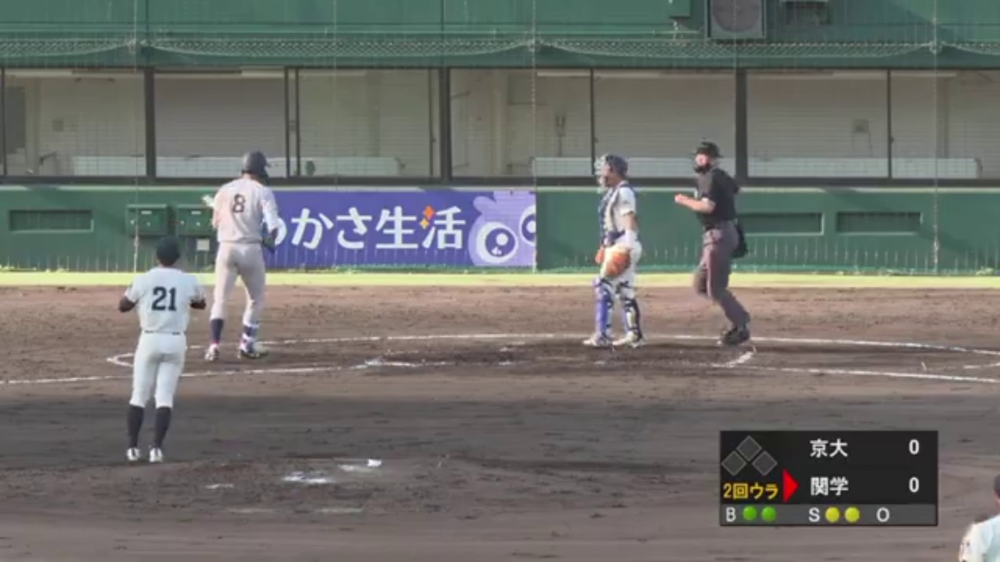
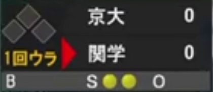

# 実際に画像で確認した例

入力画像の内容は変更していません。枠の予測と正解の注釈を混ぜずに保存しています。

## 追加学習候補：ボールランプの見落とし

`2omotefaul2.mp4` の40.0秒（0始まりframe1200）です。

画像ではボールが1個、ストライクが2個、アウトが2個点灯しています。しかし通常設定のYOLO出力は **B=0、S=2、O=2** でした。一・二塁の走者表示は両方とも検出されていました。

診断のため、**この1画像だけ**同じモデル・同じ内部切り抜き・同じimgsz960で出力下限を0.01に下げると、ball候補の信頼度は **0.197273** でした。通常の内部YOLOの出力下限0.20に届かず、さらにballを採用する位置判定側の下限0.25にも届いていません。診断用の候補は `2omote_40_low_threshold.json` に保存しました。通常の検証しきい値や判定結果は変更していません。

この例から「点灯ランプを見落とす場合がある」とはいえます。ただし、これだけで学習データ不足とは断定できません。しきい値、画質、切り抜きのずれ、既存学習例の分布も調べる必要があります。

追加注釈をするなら、`2omote_inner_40.jpg` に映る**全点灯ランプと全占有塁**を、現在と同じball/strike/out/runnerの定義で付ける候補です。同じ画像だけを多数複製するのではなく、似た失敗が出る別時刻・別動画の画像も集めてください。再学習に使った画像とは別の試合で効果を確認します。

`verified_state_review.csv` は目視で確認した**表示状態**の表です。矩形の学習ラベルではありません。`manual_audit.json` はこの1画像についての不一致であり、動画全体の誤り率ではありません。

## 条件の限界：表示が消えない場面

`2omotefaul2.mp4` の過去にファウルと目視整理していた2球目付近では、0.5秒間隔の観測で8.5〜58.0秒のスコアボード検出が継続しています。上の35.5秒でも表示が残っています。カウントは40.0秒の単発見落としを除いてB=1、S=2、O=2でした。

`2urafaul3.mp4` も0.5秒間隔では0.0〜20.0秒に表示が検出され、過去にファウルと整理していた1球目後の6.0秒にも表示が残っています。

**「消えて再表示」を必須にすると、こうした場面は対象になりません。** これはBSOの注釈を増やして解消する問題とは異なります。短時間の消失はサンプリングでも見逃し得るので、ここでの「継続」は0.5秒間隔の観測結果を指します。今回のコードは指定された条件を保ち、対象を増やすために勝手に全体へVideoMAEを実行しません。

## OCRの問題：1回を10回と読む

元表示は「1回ウラ」です。PaddleOCRは9.0秒の読み取りで `10ウラ` と認識し、回の値が10になりました。前後の読み取りには1も含まれるため、前後比較の該当項目は安定した値を確定できず不明になりました。チーム名「京大」「関学」と得点0–0はこの時刻では読み取れています。

これはBSOの矩形注釈不足とは別です。OCR領域、前処理、文字の認識・時間的一貫性の改善候補になります。誤読を手作業で1に書き換えた予測結果は使用していません。
